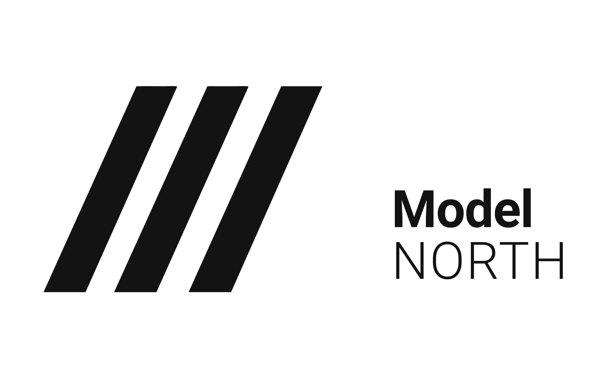
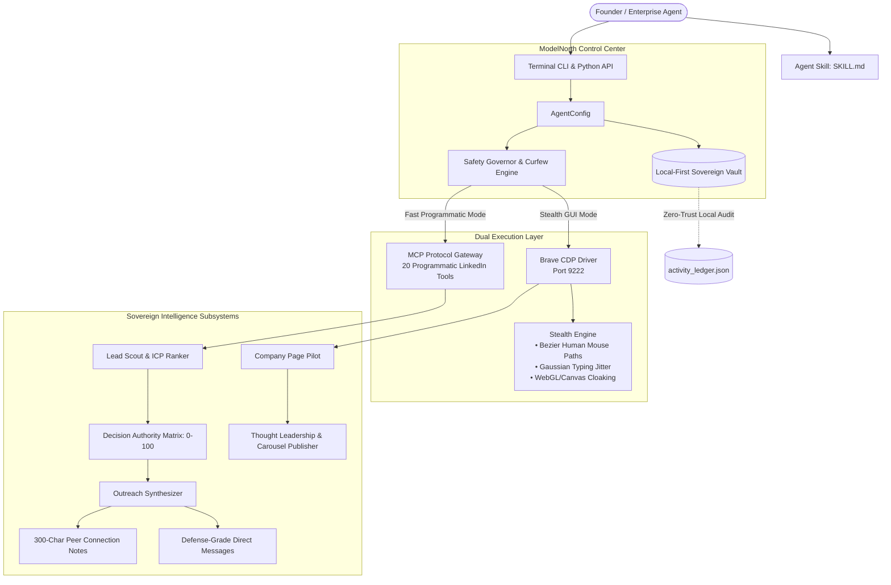

<div align="center">



# 🛡️ Sovereign LinkedIn Agent
### Autonomous, Anti-Ban LinkedIn Intelligence & Enterprise Growth Engine
**Engineered by [ModelNorth](https://modelnorth.com)**

[](LICENSE)
[](https://www.python.org/downloads/)
[](https://opentelemetry.io/)
[](https://modelnorth.com)
[](https://github.com/astral-sh/ruff)
[](https://modelnorth.com)

[**Official Website**](https://modelnorth.com) • [**Documentation**](https://github.com/modelnorth/sovereign-linkedin-agent) • [**Architecture**](#-architecture--how-it-works) • [**Quickstart**](#-quickstart)

</div>

---

## ⚡ The Problem with Legacy LinkedIn Automation

Traditional cloud tools (Phantombuster, Expandi, Waalaxy, Dripify) suffer from critical structural flaws that lead to rapid account bans:

1. **Third-Party Credential Exfiltration:** They require you to upload your raw session cookies and passwords to cloud servers, creating severe compliance violations and credential leakage risks.
2. **Naive Bot Signatures:** They run stock headless Chromium scripts with exposed `navigator.webdriver` flags, static mouse teleports, and fixed sleep timers that trigger PerimeterX, Akamai, and LinkedIn bot defenses within 48 hours.
3. **Low-Status AI Slop:** Generic GPT templates ("*Hey {first_name}, impressed by your profile at {company}*") burn your reputation with high-ticket executives.
4. **No Modern Agent Protocols:** None support the **Model Context Protocol (MCP)** for programmatic multi-agent orchestration.

**ModelNorth Sovereign LinkedIn Agent** was engineered from the ground up to solve this for sovereign AI companies, enterprise defense contractors, and high-ticket technology leaders.

---

## 🏛️ Architecture: Dual-Engine Execution

The system combines high-speed programmatic querying with an authentic, anti-ban browser automation engine:



---

## 📊 Feature Comparison Matrix

| Capability | Legacy Cloud Bots | Standard Playwright Scripts | **ModelNorth Sovereign Agent** |
| :--- | :---: | :---: | :---: |
| **Credential Security** | ❌ Stored on cloud servers | ⚠️ Plaintext local storage | 🛡️ **Zero-Trust (Never stores passwords)** |
| **Browser Execution** | ❌ Datacenter IP Headless | ⚠️ Detectable automation flags | 🚀 **Live Authentic Brave Session (CDP)** |
| **Anti-Fingerprinting** | ❌ None | ⚠️ Partial | 🛡️ **C++ Patched & WebGL/Canvas Masked** |
| **Mouse Telemetry** | ❌ Teleports (Instant clicks) | ⚠️ Linear jumps | 🧠 **Stochastic Cubic Bezier Curves** |
| **Keystroke Cadence** | ❌ Instant string injection | ⚠️ Fixed sleep delays | ⚡ **Gaussian distribution with punctuation pauses** |
| **Model Context Protocol**| ❌ No | ❌ No | 🌐 **Native MCP Bridge (20 Tools)** |
| **Lead Scoring** | ❌ Basic filters | ❌ None | 🎯 **Autonomous 0-100 Seniority Matrix** |
| **Copy Positioning** | ❌ Cheesy sales pitches | ❌ Generic templates | 🏛️ **High-Status Sovereign Technical Peer** |

---

## 🚀 Quickstart

### 1. Installation

Clone and install using `pip` or `uv`:

```bash
git clone https://github.com/modelnorth/sovereign-linkedin-agent.git
cd sovereign-linkedin-agent
pip install -e .
```

### 2. Verify System & Safety Status

```bash
sovereign-linkedin status
```

### 3. Launch Authenticated Brave Browser (Anti-Ban Mode)

To attach the agent to your authentic session without logging in via code:

```bash
sovereign-linkedin launch-browser
```
*This opens Brave with remote debugging on port 9222, automation flags disabled, and your session stored exclusively in your local vault.*

### 4. Scout & Scrape High-Ticket Leads

Filter, score, and scrape enterprise decision-makers across the GCC and global markets:

```bash
# Offline ICP evaluation & scoring
sovereign-linkedin scout --role "Chief Technology Officer" --location "Dubai, UAE" --limit 15

# Live Anti-Ban Browser Scraper (navigates search, scrolls, parses, and scores leads)
sovereign-linkedin scout --role "Chief Technology Officer" --location "Dubai, UAE" --limit 25 --live
```
*Leads are automatically deduplicated, ranked by seniority score (0-100), and saved to `~/.modelnorth/linkedin_vault/leads_export.csv`.*

### 5. Synthesize Sovereign Outreach

Generate high-status connection notes (< 300 chars) and InMails:

```bash
sovereign-linkedin synthesize \
  --name "Tariq Al-Mansoor" \
  --company "Emirates Sovereign Tech" \
  --headline "Chief Information Security Officer | Air-Gapped Infrastructure" \
  --angle sovereign
```

### 6. Autonomous Content Queue & Publishing (with OpenTelemetry Tracing)

Inspect your queued content calendar and trigger autonomous stealth publishing:

```bash
# View all scheduled and pending posts in the queue
sovereign-linkedin queue

# Publish the next pending post via Brave CDP with human keystroke telemetry
sovereign-linkedin publish-next --force

# Inspect real-time OpenTelemetry distributed traces and latencies
sovereign-linkedin traces --limit 10
```

### 7. Publish One-Off Updates to Company Page

Distribute thought leadership directly to your company feed with visual graphics:

```bash
sovereign-linkedin post-company \
  --text "Deploying deterministic multi-agent systems requires zero-trust MCP security..." \
  --media "assets/modelnorth-logo.svg"
```

---

## 🤖 Native AI Agent Skill Integration

This repository includes a production `SKILL.md` compliant with enterprise AI coding assistants and agent environments.

To install as an agent skill:
1. Drop the repository into your `.agents/skills/` directory.
2. Trigger in any chat using:
   - `/linkedin scout CTOs in Dubai`
   - `/linkedin synthesize outreach for Tariq`
   - `/linkedin publish company update`

---

## 🛡️ Anti-Ban Defense Details

### Biomechanical Bezier Trajectory
Unlike bots that jump straight to coordinates $(X, Y)$, our `StealthEngine` calculates a cubic Bezier path with stochastic control point dispersion:

$$B(t) = (1-t)^3 P_0 + 3(1-t)^2 t P_1 + 3(1-t) t^2 P_2 + t^3 P_3 \quad \text{for } t \in [0, 1]$$

Every movement incorporates natural hand micro-jitter ($\pm 1.2\text{px}$) and smooth acceleration/deceleration.

### Gaussian Typing Cadence
Characters are typed with stochastic delays:
- **Alphanumeric:** 40ms – 110ms
- **Punctuation pauses:** 200ms – 450ms after `.`, `,`, `!`, `?`
- **Whitespace breathing:** 50ms – 120ms

---

## 📜 License: ModelNorth Sovereign Open License (MN-SL v1.0)

Copyright (c) 2026 [ModelNorth](https://modelnorth.com). All rights reserved.

- **Free Use:** You are free to inspect, fork, modify, self-host, and run this agent internally for personal, agency, or enterprise deployments.
- **Mandatory Attribution:** Prominent credit to **ModelNorth** (`https://modelnorth.com`) must be preserved in all derived works, CLI output banners, and documentation.
- **Trademark Protection:** You may not rebrand or obscure ModelNorth's authorship or utilize ModelNorth trademarks for commercial confusion.
- **Hosted SaaS Restriction:** Offering this software as a commercial multi-tenant hosted SaaS competing directly with ModelNorth cloud services requires a commercial license.

For commercial licensing and enterprise sovereign deployments:  
📧 **licensing@modelnorth.com** | 🌐 **[https://modelnorth.com](https://modelnorth.com)**
